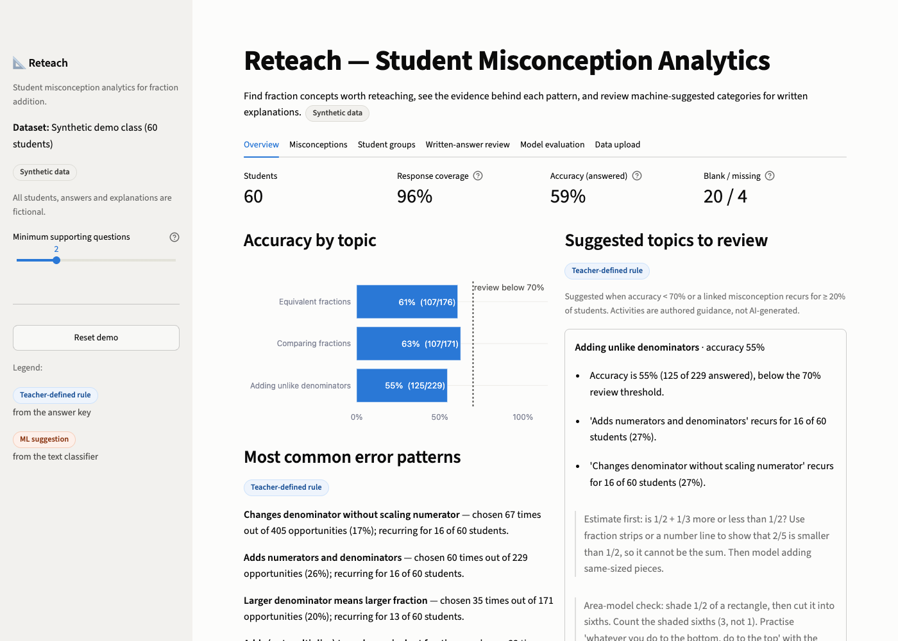
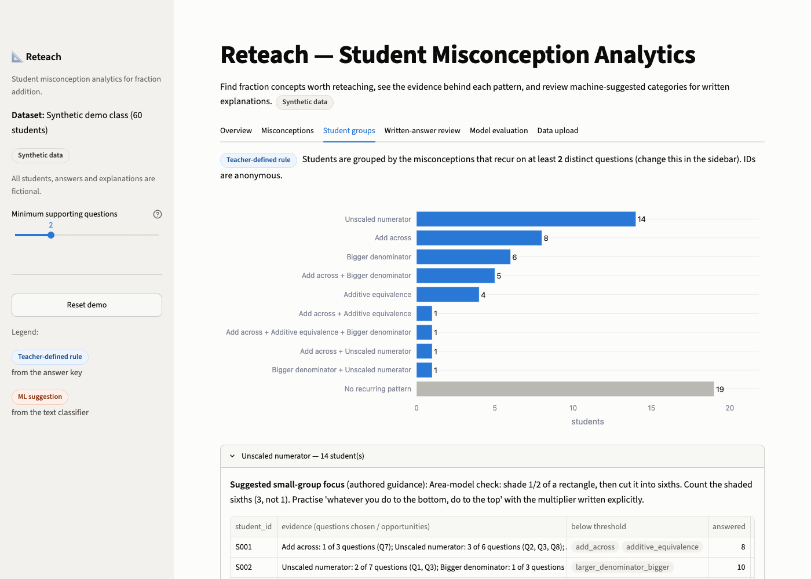
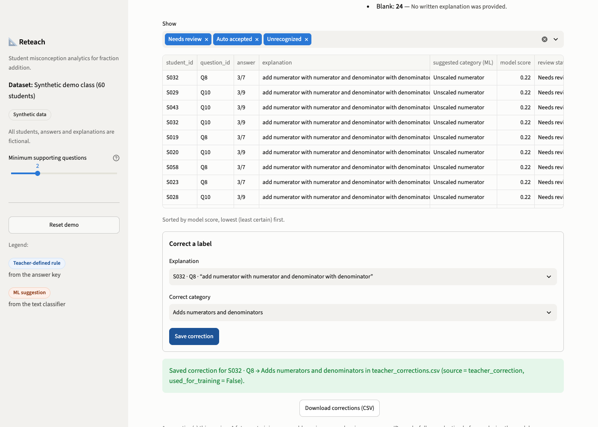
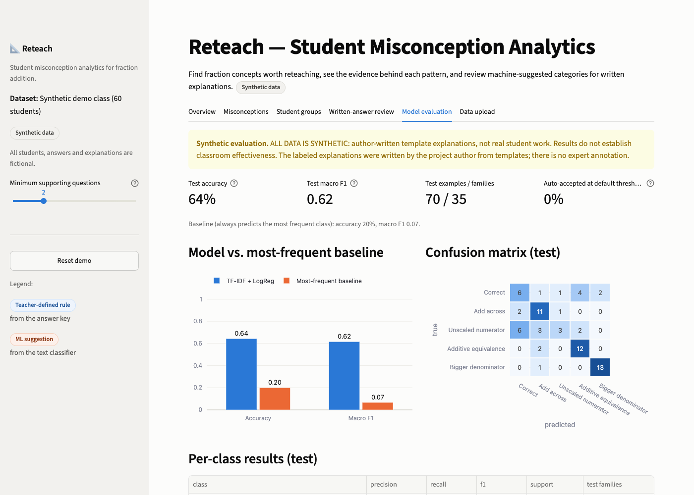

# Reteach — Student Misconception Analytics

A teacher-facing Streamlit dashboard that analyses fraction-quiz responses and shows which
concepts are worth reteaching, along with the evidence for each suggestion.

> **All data in this repository is synthetic.** The 60 students are fictional, their answers
> come from a seeded random generator, and every written explanation was authored by the
> project author from templates. No real students, schools or classrooms are involved. No
> expert annotated the data, and nothing here shows that the tool improves learning.



| Student groups | Teacher review & correction | Model evaluation |
|---|---|---|
|  |  |  |

*Screenshots of the synthetic demo, captured with headless Chrome.*

## The problem

When a class gets a fraction question wrong, the wrong answers are rarely random. A student who
answers `1/2 + 1/3 = 2/5` is probably adding across, and a student who answers `2/6` probably
found a common denominator but forgot to scale the numerators. If a teacher can see which wrong
ideas *recur*, and for whom, they can plan a targeted reteach instead of repeating the whole
lesson.

Reteach focuses on one skill, **adding fractions with unlike denominators**, plus two
prerequisites: **equivalent fractions** and **comparing fractions**.

## What a teacher can do

| View | What it shows | Source |
|---|---|---|
| **Overview** | Students, response coverage, accuracy, common error patterns, suggested topics with the reason for each, Markdown report export | Rules |
| **Misconceptions** | Each misconception with chosen/opportunity counts, student denominators, supporting questions, example answers, student IDs | Teacher-defined answer key |
| **Student groups** | Anonymous groups with recurring patterns, evidence such as "2 of 4 questions", and an adjustable minimum-support threshold (default 2) | Rules |
| **Written-answer review** | Explanation, ML-suggested category, model score, review status, teacher correction | **ML** (TF-IDF + logistic regression) |
| **Model evaluation** | Comparison with a baseline, confusion matrix, per-class metrics, threshold trade-off, errors, limitations | Saved evaluation |
| **Data upload** | Templates, schema guidance, actionable validation messages | Validation |

The app keeps **teacher-defined rules** (the answer-key mapping from distractor to
misconception) visibly separate from **machine-learning suggestions**, using a blue "Teacher-defined rule"
badge and an orange "ML suggestion" badge. Rule-based lookups are never presented as AI.

## Quick start

Requires Python 3.11 or newer.

```bash
git clone https://github.com/adamelhouzaly/reteach-analytics.git
cd reteach-analytics
python3 -m venv .venv
source .venv/bin/activate
pip install -r requirements-dev.txt

streamlit run app.py                 # launch the app (the demo loads automatically)
```

| Task | Command | Make |
|---|---|---|
| Regenerate demo data | `python -m reteach.cli generate-data` | `make data` |
| Train the classifier | `python -m reteach.cli train` | `make train` |
| Train + evaluate, write `artifacts/` | `python -m reteach.cli evaluate` | `make evaluate` |
| Run tests | `python -m pytest` | `make test` |
| Lint | `ruff check .` | `make lint` |

If `models/` is empty, the app trains the classifier from the bundled data on first launch,
which takes about a second. It never loads pickle or joblib files from uploads.

## 90-second demo walkthrough

1. **Overview.** 60 synthetic students and 96% response coverage. *Adding unlike
   denominators* is suggested for review because accuracy is 55% **and** two misconceptions
   recur for 27% of students. Each reason is listed. Download the report.
2. **Misconceptions.** "Adds numerators and denominators" was chosen 60 times out of 229
   opportunities. Each card shows the supporting questions, the IDs of students for whom
   it recurs, and students with only one supporting question (insufficient evidence).
3. **Student groups.** Move the *Minimum supporting questions* slider from 2 to 1 and watch
   the groups grow. A single wrong answer is evidence, not a diagnosis.
4. **Written-answer review.** Every prediction is routed to review by default (explained
   below). Pick an explanation, correct its category, and save. The correction goes to
   `outputs/teacher_corrections.csv` with provenance and is **not** used for retraining.
5. **Model evaluation.** Comparison with the baseline, the confusion matrix, and the
   honest limitations.
6. **Data upload.** Upload `data/invalid/responses_messy.csv` and read the specific
   validation feedback.

A fuller script is in [docs/demo_script.md](docs/demo_script.md).

## Misconception taxonomy

| Label | Name | Example (correct answer in brackets) |
|---|---|---|
| `add_across` | Adds numerators and denominators | 1/2 + 1/3 = 2/5  [5/6] |
| `unscaled_numerator` | Changes denominator without scaling numerator | 1/2 + 1/3 → 1/6 + 1/6 = 2/6  [5/6]; 2/3 = 2/9  [6/9] |
| `additive_equivalence` | Adds (not multiplies) to make equivalent fractions | 1/2 = 7/8 by adding 6  [4/8] |
| `larger_denominator_bigger` | Larger denominator means larger fraction | 1/5 > 1/3  [1/3] |
| `correct_reasoning` | Correct reasoning (text classifier only) | 1/2 + 1/3 = 3/6 + 2/6 = 5/6 |

Handling states are *not* forced into a category:

- **Blank:** no explanation written.
- **Insufficient text:** fewer than 3 words, such as "idk".
- **Unrecognized:** none of the words appear in the model's vocabulary.
- **Needs review:** the model score is below the threshold.
- **Unmapped wrong answer:** a wrong multiple-choice option with no misconception label.

Every multiple-choice question has exactly one correct option. When a question declares an
`operation` (`add`, `equivalent` or `compare_larger`), validation uses
`fractions.Fraction` to recompute the correct answer **and** the value each misconception
would produce. It rejects any answer key where they disagree, and flags unlabelled distractors
that match a misconception pattern.

## Data and CSV schemas

**Questions** (one row per answer option):
`question_id, topic, prompt, option_id, option_text, is_correct, misconception_label`.
Optional: `operation, operand_a, operand_b`, which enable arithmetic checking.

**Responses**: `student_id, question_id, selected_option`. Optional: `explanation`.

**Labeled explanations** (training data): `example_id, question_id, explanation, label,
source, group_id`. Here `question_id` refers to a numeric context in
`data/labeled/contexts.csv`.

Templates you can download are in `data/templates/`, and deliberately broken inputs are in
`data/invalid/`.

### How missing and invalid data is treated

| Situation | Treatment |
|---|---|
| Blank `selected_option` | Kept as **unanswered**. Excluded from accuracy and reported in coverage. Never counted as wrong or as a misconception. |
| No row for a student/question | **Missing**. Same treatment as unanswered, reported separately. |
| Duplicate student + question | Last row kept, with a warning that gives line numbers. |
| Unknown `question_id` | Row dropped, with a warning. |
| Option not in that question | Row dropped, with a warning. |
| Blank `student_id` | Row dropped, with a warning. |
| Empty file, header only, missing column, two correct options, wrong arithmetic | Blocking error with a specific message. |

**Accuracy = correct ÷ answered.** "Students" means anyone with at least one response row.
Expected responses = students × questions.

## Data provenance

| Data | Source |
|---|---|
| Quiz (10 questions) | Written by the author. Arithmetic verified programmatically. |
| 60 students | Synthetic, from `reteach/datagen.py` with seed 42. There are eight behaviour profiles (secure, add-across, unscaled, additive, larger-denominator, mixed, developing, guessing). |
| Labeled explanations | **Author-written templates**: 100 reasoning *families* (20 per class), each with 2 paraphrases (`source = synthetic_template_author_written`). The family is the `group_id`. |
| Demo-class explanations | A **separate** author-written pool, so app predictions are made on wording the model never trained on. |

No public dataset is used. The Eedi "Mining Misconceptions in Mathematics" Kaggle competition
data is relevant, but it is distributed under competition terms that require a Kaggle account,
and I did not download it or verify its licence. The project uses only transparent synthetic
data instead.

## Measured results (synthetic test split, seed 42)

| Model | Accuracy | Macro F1 |
|---|---|---|
| TF-IDF + logistic regression (C = 0.3) | **64.3%** | **0.616** |
| Most-frequent-class baseline | 20.0% | 0.067 |

There are 70 test explanations from 35 template families that the model never saw, written
over **held-out question contexts** (different numbers). The weakest class is
`unscaled_numerator` (recall 0.21), which is often mistaken for correct reasoning because both
talk about "common denominators". The strongest is `larger_denominator_bigger` (F1 0.90).

**Review threshold.** I fixed the policy before seeing any results: auto-accept only at a
score where *validation* accepted-accuracy reaches 90%. No threshold met it, because the
regularised model's scores stay below about 0.3 across 5 classes. So **every prediction is
routed to teacher review by default.** That is the system working as designed for a weak
model; the policy was not loosened afterwards. Teachers can lower the threshold in the app,
and the validation coverage and accuracy for each setting are shown next to the control.

Full details are in [docs/evaluation.md](docs/evaluation.md),
[artifacts/metrics.json](artifacts/metrics.json) and the
[model card](docs/model_card.md).

**These numbers describe author-written synthetic text. They do not predict performance on
real student writing and say nothing about classroom effectiveness.**

## Architecture

```
app.py                     Streamlit presentation only
reteach/
  taxonomy.py              categories, handling states, authored review guidance
  arithmetic.py            fractions-module answer-key checks
  validation.py            CSV schemas + validation (errors vs. warnings)
  analytics.py             coverage, accuracy, misconception counts, topic suggestions
  grouping.py              recurring-pattern evidence and student groups
  model.py                 TF-IDF + LogisticRegression pipeline, split, threshold, inference
  evaluate.py              training/evaluation run, metrics.json, evaluation report
  report.py                Markdown reteaching report
  corrections.py           teacher-correction store (never auto-retrains)
  explanation_bank.py      author-written explanation templates
  datagen.py               deterministic synthetic data generator
  cli.py                   generate-data | train | evaluate
data/                      demo, labeled, templates, invalid samples
artifacts/                 saved metrics and evaluation report
tests/                     pytest suite (incl. headless Streamlit AppTest)
docs/                      model card, evaluation, demo script, learning guide, resume bullets
```

Data flows **CSV → validation → scored responses → analytics/grouping (rules)** in one
branch, and **explanations → classify (ML + handling rules) → teacher review → corrections
file** in the other.

## Limitations

- **Synthetic everything.** The text is cleaner and more formulaic than real student writing.
- **Small evaluation.** There are 35 test families (7 per class). One family more or less
  changes per-class numbers noticeably.
- **Bag of words.** TF-IDF can't see *whether* numerators were scaled. Single digits are
  dropped by the tokenizer, so the actual arithmetic in an explanation is ignored.
- **Uncalibrated scores.** Calibration was not evaluated.
- **Grouping ignores opportunity count.** A misconception offered on 7 questions
  (`unscaled_numerator`) is easier to hit twice by chance than one offered on 3. The UI shows
  "*k* of *n* questions" for this reason.
- **The answer key is the teacher's hypothesis.** A distractor choice can come from guessing or
  a slip, not the labelled misconception.
- **Not validated with teachers or students.** No usability study, deployment or outcome
  measurement has been done.

## Teacher corrections and retraining

Corrections are written to `outputs/teacher_corrections.csv` (ignored by git) with
`source = teacher_correction`, the reviewer, a timestamp, the model's original label and
score, and `used_for_training = False`. The model is **never** retrained automatically. A
reviewed retraining workflow would:

1. Have a second person check each correction.
2. Assign group IDs so related corrections stay in one split.
3. Append the corrections to the labeled data with their provenance.
4. Re-run `python -m reteach.cli evaluate` and compare against the saved metrics before
   replacing the model.

## Tests and CI

`python -m pytest` runs 51 tests. They cover answer-key arithmetic, schema and input
validation, metric denominators, recurring-pattern grouping, blank and unknown responses,
the absence of group or context overlap between training and test, training and inference
handling states, report and correction export, and headless app smoke tests (including
the correction flow). GitHub Actions runs lint, a reproducibility check on the generated data,
the evaluation and the tests on Python 3.11 and 3.12.
